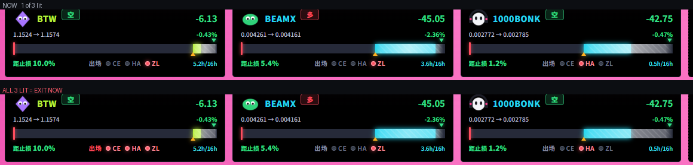
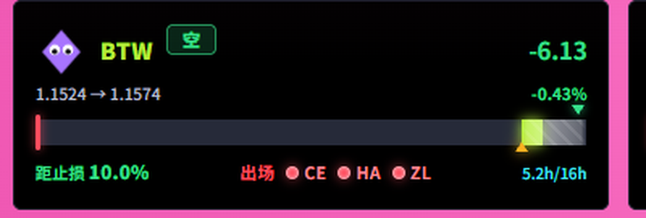
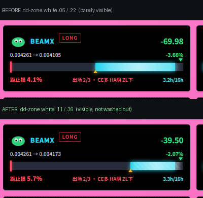
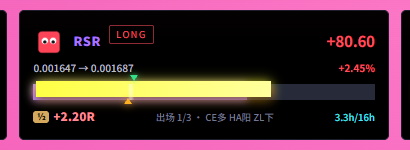

# 归档 · 2026-11-08 夜间：雷达幽灵卡 + 持仓卡视觉三批

> 这一晚全部是**看得见的东西**：先把雷达面板多出来的 8 张幽灵卡连根拔掉，
> 再把持仓卡上那套**早就失效的旧出场可视化**整个删掉，换成真实的镜像出场三闸；
> 最后按浩哥的三条要求收尾 —— 币种字放大、"LONG/SHORT" 换成汉字按钮、出场文字换成三盏灯。
>
> 中途踩了 4 个坑，其中「改了 CSS 不生效」那次最典型：**改错了文件**。

---

## 一、本轮 5 个提交

| SHA | 内容 | 关键数据 |
|---|---|---|
| `9495b00` | 雷达面板只显示当前持仓的币 | **12 张 → 4 张**，幽灵卡清零 |
| `182c282` | 持仓卡出场规则改成镜像出场三闸（文字版） | 删掉 5 道假触线标；轨道 341×16 不变 |
| `ce4bc2b` | 插针回看窗口对比回测脚本（备查） | 96h 491 笔 +55.3R vs 24h 541 笔 +43.1R |
| `9294394` | 回撤区调亮到看得见 + 修主题覆盖错位 | 白度 .05/.22 → **.11/.36**；顺手修 paper 被白斜纹覆盖 |
| `3e7ba33` | 币种字加大 + 多空改汉字按钮 + 出场改三盏灯 | 12.5→**14px**；灯 **8×8**；LONG/SHORT→多/空 |

改动面：6 个文件，+455 / −182 行。

---

## 二、雷达幽灵卡：问题在后端，不在前端

浩哥原话：

> 「雷达小卡不跟随持仓变动，持仓清零也不消失，减少了也不减少，之前进去的一直挂在上面」

**查的顺序（值得记）：**

1. 先读 `RadarPanel.jsx` —— 完全受控组件，`rows` 直接来自 props，**自己一点数据都不攒** → 前端无罪，100% 在后端
2. grep 后端 `dir_now|z_now|_S15_ZL_CACHE` —— 零命中，不是状态没吐出来
3. 直接查库对比：`radar_history` 里 **12 个不同币**，`positions` 里只有 **4 个** → 差 8 张
4. 读 `/api/radar` 路由（`main.py:410-465`）—— 循环 `radar.latest()` 取每币最新一条，**全程没有一句判断这个币还持不持仓**

**根因：** `radar_history` 只增不删，平掉的仓永远躺在表里，接口照单全收。

**修法：**

```python
rows = radar.latest()
alive = {(x["symbol"], x.get("side")) for x in db.open_positions()}
for r in rows:
    if (r.get("symbol"), r.get("side")) not in alive:
        continue           # 不带 symbol 参数的列表查询才过滤
```

带 `symbol` 参数的单币查询**不过滤**（那是主动查历史，不是看当前列表）。

**结果：12 → 4，与 4 个持仓一一对应。**

---

## 三、持仓卡：删掉的那套东西，全是假的

卡片上原来那一堆标记，不是「字写错了」，是**整套旧出场逻辑的可视化**，而这套逻辑早就被镜像出场取代了：

| 删掉的 | 为什么是假的 |
|---|---|
| 红色倒三角「回撤出局线」 | 写着「峰顶 − 0.8R 出局」，但**镜像出场根本没有「回撤多少 R 就出场」这个概念** → 这条线永远画着，永不触发 |
| 线旁两个小圆点 | 图例「亮一个=碰过一次，亮两个=该出场」→ **永远不会亮** |
| 「破均线 0/2」 | `ma_break_cnt` 上一版已从 API 剔除 → **永远显示 0/2** |
| 「回撤 X/0.80R」 | 门槛值永远是前端自己兜底的 0.8 |

**浩哥原话：**

> 「持仓卡 中间还保留轨道啊 只是去掉老的5道触线标 保留R 轴、主填充、峰顶箭头、当前价游标、峰顶→当前价的回撤区， 怎么会空呢 布局不变啊」

照办 —— 删完实测：

| 项 | 改前 | 改后 |
|---|---|---|
| 轨道尺寸 | 341×16 | **341×16** |
| 主填充 / 峰顶箭头 / 当前价游标 / 回撤区 | 有 | **都在** |
| 旧 5 道触线标 | 4 套 | **0** |
| 附带清掉的死 CSS | — | 87 行（build CSS −2.45 kB） |

---

## 四、出场改成真实三闸

后端 `_mirror_exit`（`strategies.py:712-802`）真实判定只有三条：

| 闸 | 多头何时算过 | 空头何时算过 |
|---|---|---|
| ① CE 转向 | CE 由多翻空 | CE 由空翻多 |
| ② HA 变色 | HA 由阳转阴 | HA 由阴转阳 |
| ③ ZL 上下 | 跌破 ZLSMA50 | 站上 ZLSMA50 |

**代码里 ②③ 是合并成一个 `ha_ok = ha_rev and z_break` 的**，显示层拆成两条单独展示，语义完全一致。

新增 API 字段（**只读 `_S15_ZL_CACHE`，不新增任何判定逻辑**）：

```
exit_n / exit_ce_flip / exit_ha_rev / exit_z_break
exit_ce_dir / exit_ha_bar / exit_z_side
```

刚开仓或跨 K 线窗口那一瞬没缓存 → 返回 `null`，前端显示 `--`。

---

## 五、浩哥的三条视觉要求（最后一批）

> 「1. B种 字体再加大一号。 2.多空变成汉字 按钮形式展示。3出场 改成亮灯
> 现在这种写字 有点看不懂 （直接 CE转向->灯/ HA变色->灯/ ZL上下->灯）」

**关于「B种」：** 就是「**币种**」，拼音打出来是 B 种。同日 11-07 的归档第 49 行有浩哥原话佐证 ——「只有B种名字加糖果色」——**指的是币种名，不是别的元素。**

### 5.1 币种名 12.5 → 14px

只作用于**玫红主题的持仓卡**：`html:not([data-theme]) ... .card.work .k`。

**为什么不直接改上面那条已有的规则？** 因为它写的是
`:is(html:not([data-theme]), html[data-theme="paper"])` —— **同时管纸面主题**，而 paper 只覆盖了 `color`、没覆盖 `font-size`，直接改会把纸面的币种也一起变大。

新加的这条特异性相同、位置在后，靠「后加载」胜出 → paper 和空卡都不受影响。

### 5.2 多空 → 汉字按钮

| | 改前 | 改后 |
|---|---|---|
| 文字 | `LONG` / `SHORT` | **`多`** / **`空`** |
| 字号 | 8~9.5px | **11px / 800** |
| 形态 | 细描边小签、字间距 .14em | 实心淡底 + 描边 + 圆角 4px + padding 3px 9px |
| 配色 | JSX inline style 二选一 | **多 = 红底红字** `rgba(255,77,94,.16)` / **空 = 绿底绿字** `rgba(53,224,138,.16)` |

跟着浩哥的「红涨绿跌」走，没改语义。原来 JSX 那段 inline style 一并删掉，交给 class。

### 5.3 出场三盏灯

```
出场  ● CE   ● HA   ● ZL
```

| 状态 | 样子 |
|---|---|
| 灭 | 8×8 暗灰圈 `#3d4452` + `#5a6274` 边框 —— 看得出是颗灯 |
| 亮 | 8×8 红点 `#ff4d5e` + 7px 辉光 |
| 三颗全亮 | 「出场」二字变红 + 三颗灯一起呼吸（1s），`prefers-reduced-motion` 下自动关 |

**详细状态（CE 偏多/偏空、HA 阳/阴、ZLSMA 价在上/在下 + 峰顶回撤）全保留在 hover title 里**，鼠标移上去就能看，不占版面。

JSX 变量顺势整理：原来只有 `exitN` 合计和 `ceTag/haTag/zTag` 三个文字串，现在按闸拆成 `ceFlip / haRev / zBrk` 三个布尔，一一对应三颗灯。

**实测三张持仓卡的灯与 title 逐条对得上：**

| 币 | 方向 | 亮哪颗 | 原因 |
|---|---|---|---|
| BTW | 空 | **ZL** | 价格已站上 ZLSMA |
| BEAMX | 多 | **ZL** | 价格已跌破 ZLSMA |
| 1000BONK | 空 | **HA** | HA 已转阳 |





---

## 六、回撤区调亮：改了两轮才对

### 6.1 第一轮白改

把 `v2.css` 里的 `.dd-zone` 从 `.30/.72/.55` 提到 `.55/.92/.78`，build 成功，**结果去量 computed 值，还是老样子。**

### 6.2 真凶

```
v2.css   .spider-root .cards .card .bar.prog .dd-zone                     特异性 (0,5,0)
spider.css  :is(html:not([data-theme]), html[data-theme="paper"]) .spider-root ... .dd-zone   特异性 (0,6,1)
```

**玫红主题的 `background` 实际由 `spider.css` 那条控制，把 v2.css 整个盖住了。**
v2.css 那条只留下 `mask`（羽化）在生效 —— 所以才会出现**「一个属性生效、一个不生效」**的怪现象，这正是判断改错文件的关键线索。

### 6.3 而且原来是故意压暗的

`spider.css:433` 留着前人的注释：

> 回撤区：原来整条是白色斜纹 + .72 白渐变，**把底下的彩色全糊成银灰**。降到 .18/.34，只当"回撤量"的淡底纹。

所以不是「忘了调」，是**压过头了** —— 实测值只剩 `.05`/`.22`。

### 6.4 取中间值

| | 改前 | 改后 |
|---|---|---|
| 盈利态 | 斜纹 .06 / 渐变 .07→.22→.15 | **.14 / .16→.44→.32** |
| 亏损态 | 斜纹 .05 / 渐变 .10→.26→.18 | **.11 / .13→.36→.26** |

人工核对：**斜纹可辨、左右界线清楚、没有过曝糊成灰白、层次清晰。**
BEAMX 那张卡回撤区实测 **103px 宽**，现在一眼能看到「回撤了多少」。

### 6.5 顺手修一个既有 bug

那条 `:is(html:not([data-theme]), html[data-theme="paper"])` **连 paper 主题也匹配** —— 白色斜纹铺在米白纸上等于看不见。已收窄成 `html:not([data-theme])`，paper 回落到它自己那条墨色规则（`rgba(21,21,21,...)`，那才是早期就写对的，只是被盖住了）。



---

## 七、平半（满 2R 后半仓）在轨道上的呈现 —— 一直都有

浩哥问：「那满2r 后半仓 后的这个放道上去了么」

**在的，而且本轮零改动**（`git diff` 确认 `base2r` / `halflayer` / `half-tag` 0 行变更）。平半后轨道上是三层叠的：

| 层 | 画什么 | 意思 |
|---|---|---|
| `base2r` 红线铺底 | 0R → 2R | 主仓已经打完平半这一仗 |
| `halflayer` 橙黄条 | 0R → 当前价，**斜上 45° 错位 3px 叠在红线上**，带投影 + 辉光 | 剩下的半仓还在跑多远 |
| `half-tag` ½ | 第 4 行左侧 | 标记「这是半仓」 |

当前 3 个持仓最高只有 0.26R，**一个都没到 2R**，所以屏幕上看不到 —— 不是丢了。



---

## 八、踩的 4 个坑（值得记住）

### 坑 1 · `.get(键, 0)` 把「不存在」伪装成「等于 0」

用 `.get("position_n", 0)` 查 `/api/status`，得到 0，当场判定「4 个持仓全平了」——**实际字段叫 `open_positions`，只是一直是 4。**

**教训：查字段先确认键存在，别拿默认值当读数。**

### 坑 2 · 改了 CSS 不生效 → 先怀疑改错文件

同一个属性一个生效一个不生效，几乎一定是**有更具体的选择器在覆盖**。用 `getComputedStyle` 量真实值 + 遍历 `document.styleSheets` 找命中的规则，比看源码猜快得多。

### 坑 3 · `:is(a, b)` 是并集，改它会连累 b

给玫红调样式时用 `:is(html:not([data-theme]), html[data-theme="paper"])` 会**同时命中纸面主题**。要分开就写两条独立规则，靠特异性或顺序控制。

### 坑 4 · `elementFromPoint` 会穿透 `pointer-events: none`

拿它判断「元素有没有被遮挡」是错的 —— `dd-zone` 设了 `pointer-events: none`，所以点它中心永远返回下层的元素，看着像被盖住了，其实没有。**判断遮挡要看 `z-index` 和实际渲染。**

---

## 九、收尾状态

| | |
|---|---|
| 服务 | 净值 **9,763.15U**、3 持仓、监控池 39、未熔断、`last_error` 空 |
| 今日已实现 | **−301.84U**（13 笔平仓） |
| RSR | **22:35 手动全平，+73.61U**（+2.29%，持 3.4h） |
| 回归测试 | 7 个测试文件全过（144/144） |
| 工作区 | 干净，5 个提交已推送 |
| MAC / 纸面主题 | 一行没碰 |

**下一轮要盯的：**

- BEAMX 曾到过 2/3（HA 阴 + ZL 下，只差 CE 翻空），现在回到 1/3 —— 这笔一直在出场边缘反复
- 1000BONK 距止损只剩 **1.1%**，随时可能止损
- 实盘仍卡在币安 API KEY 未填，私有接口**0 次真实调用**
