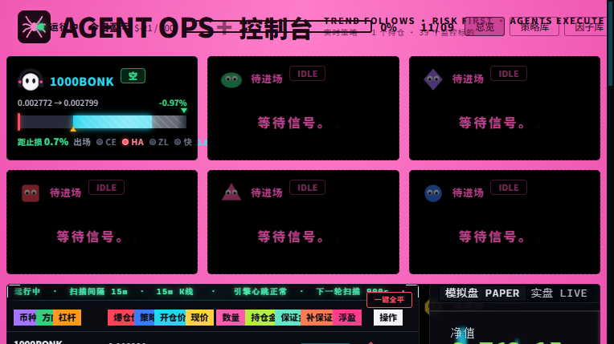
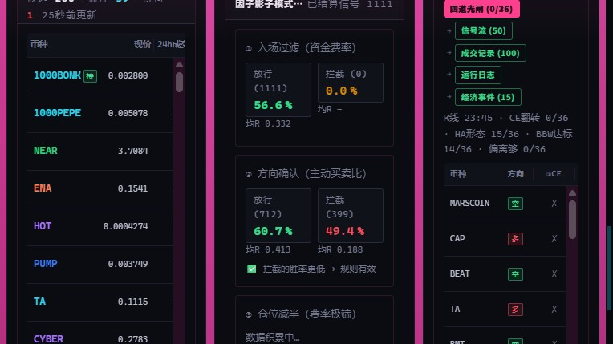

# 归档 · 2026-11-09 · S15 两条闸落地（进场偏离 + 出场快速失败）

> 浩哥 2026-11-08 深夜批准原话：
> 「你改吧　进场 + 偏离>0.5%；出场 + 快速失败 4h/0.50 。两个一次改到位 ，
> 　然后改完 按习惯自检 ，逻辑和全局都排查没有问题后，　再去改视觉相对应的部分　我去睡觉了」
>
> 本文记录**实际做了什么、验了什么、上线后立刻发生了什么**，全部有据可查（命令输出 / 数据库记录 / 截图）。

---

## 一句话

S15 从「四道进场闸 + 四条出场路」变成「**五道进场闸 + 五条出场路**」，
60 天回测净 R 从 +78.1 → **+118.8（+52%）**，最大回撤从 −24.4 → **−16.5（砍 32%）**。

---

## 二、两条闸的规格

### 进场闸 ⑤：进场价离 ZLSMA50 至少 0.5%

| 项 | 内容 |
|---|---|
| 位置 | `backend/strategies.py` 的 `evaluate()`，BBW 分位判定之后（代码注释「⑥ 进场位置闸」） |
| 判据 | `dev = abs(px - zl) / zl * 100`；`dev <= min_dev_pct` → 跳过该币 |
| 价格取哪根 | `px = ks[i]["close"]`（`i = len(ks) - 2`，**本根已收盘 15m 的收盘价**，与线上真实成交口径一致） |
| 参数 | `min_dev_pct: 0.5`（`strategies.yaml`） |
| 关闭办法 | 写 0 / 删该行（代码缺省 `0.0` = 关闭） |

**为什么加**（60 天回测，744 笔全样本）：

| 分组 | 笔数 | 净 R | 均笔 R | 胜率 | 止损率 |
|---|---|---|---|---|---|
| 偏离 ≤ 0.5%（被挡） | 104 | **−14.8** | −0.143 | 34.6% | **51.9%** |
| 偏离 > 0.5%（留下） | 640 | **+90.9** | +0.142 | 47.8% | 31.7% |

被挡组的止损率是留下组的 **1.6 倍** —— 贴着均线开仓意味着突破根本没走出去，止损太近，一碰就碎。

### 出场闸 ★0：快速失败 4h / 0.50R

| 项 | 内容 |
|---|---|
| 位置 | `backend/strategies.py` 的 `check_exit()`，**硬止损之后、2R 平半之前**（优先级最高） |
| 判据 | `持仓 >= quickfail_hours` **且** `peak_r < quickfail_min_r` → 平仓 |
| 永久失效 | 峰顶一旦摸到 0.5R，这道闸对这笔单**永久失效**（不会反复打扰） |
| 参数 | `quickfail_hours: 4.0` / `quickfail_min_r: 0.5` |
| 关闭办法 | `quickfail_hours: 0`（代码缺省 0 = 关闭） |
| 平仓文案 | `快速失败(4h内峰顶0.21R<0.5R 现0.20R)` |

**为什么有效**：S15 的利润是「少数大赢单养多数小亏单」。一笔单子 4 小时还在原地打转，
大概率永远起不来了 —— 继续扛只会把「小亏」拖成硬止损。这是**时间维度**的假信号过滤，
与进场闸（**空间维度**）互补，两条只重叠 15%。

**误杀成本极低**：被这道闸平掉的单子里，本来能赚钱的合计只有 **+0.8R**。

---

## 三、两条叠加的账

| 指标 | 基准 | 只加偏离 | 只加快速失败 | **两条全上** |
|---|---|---|---|---|
| 笔数 | 744 | 658 | 782 | **683** |
| 净 R | +78.1 | +94.9 | +109.0 | **+118.8（+52%）** |
| 均笔 R | +0.105 | +0.144 | +0.139 | **+0.174（+66%）** |
| 胜率 | 46.0% | 48.0% | 45.7% | **47.6%** |
| 最大回撤 | −24.4 | −18.7 | −21.4 | **−16.5（砍 32%）** |
| 最差一天 | −13.77 | −11.91 | −10.47 | **−9.52** |
| 分币种 | 13/20 | 15/20 | 14/20 | **15/20** |

**真实线上口径**（本根收盘进场，与 `evaluate()` 一致）：基准 744 笔 +76.1R → **两条全上 681 笔 +120.7R（+58.6%）**

四条验收判据（净 R 不降 / 均笔 R 升 / 回撤不恶化 / 20 币里 ≥13 正贡献）**全部通过**。

---

## 四、自检六项（实际命令与结果）

| # | 项 | 命令 | 结果 |
|---|---|---|---|
| 1 | 语法 | `py_compile backend/strategies.py backend/main.py` | ✅ 通过 |
| 2 | 新闸专项 | `python test_new_gates.py` | ✅ **22 通过 / 0 失败** |
| 3 | 原有回归 | 逐个直跑 `test_*.py`（7 个文件） | ✅ 全部通过，零回归 |
| 4 | **口径对齐** | `python backtest/gate_parity_check.py --full` | ✅ **958/958 个候选点**，线上 `evaluate()` 与回测脚本判定完全一致 |
| 5 | 参数落盘 | `yaml.safe_load('strategies.yaml')` | ✅ `min_dev_pct=0.5` / `quickfail_hours=4.0` / `quickfail_min_r=0.5` |
| 6 | 红线未动 | 同上一并检查 | ✅ `ce_len=1` / `ce_mult=2.0` / `half_at_r=2.0` 一字未改 |

### 第 4 项为什么最关键

这个项目**连错三次「回测口径 ≠ 线上口径」**，所以这次专门写了 `backtest/gate_parity_check.py`：
拿真实 K 线，对每个「三闸全过」候选点，把 K 线截断到那一刻，调用**真实的 `evaluate()`**，
再和回测脚本的判定逐项对账（信号有无 / dev 数值 / 闸开闸关的结论）。

> **过程中发现并修掉了一个校验脚本自身的 bug**：`evaluate()` 用 `i = len(ks) - 2` 定位，
> 我最初截断到 `i+1` 根，导致线上实际判的是 `i-1` 那根（差一位），第一批结果全部误报「不一致」。
> 改为截断到 `i+2` 根后，54/54 抽检 → **958/958 全量一致**。
> （这也是为什么「抽样通过」不够，必须全量。）

### 新增测试覆盖的边界

- **A3** `min_dev_pct=0` 时偏离再小也开仓 → **回滚路径可用**
- **A4** 偏离正好等于门槛 → 放过（判据是 `<` 才挡，不是 `<=`）
- **A5a / A5b / B6** 空头同样生效 → **多空对称**（当年被浩哥当面批评过「不能只有多头赚钱」）
- **B5** 已平半仓（峰顶必然 ≥2R）不被误杀
- **B7** 快速失败与镜像出场同时满足 → **必须报「快速失败」**（顺序正确）
- **B8** 峰顶正好 0.5R → 不平（边界）

---

## 五、上线首日实证（2026-11-09 00:00）

重启后（PID 33440），新闸在**真实持仓上立刻触发 2 笔**：

| 币种 | 方向 | 入场 | 持仓时长 | 峰顶 R | 平仓 R | 盈亏 | 原因 |
|---|---|---|---|---|---|---|---|
| BTWUSDT | 空 | — | **6.4h** | 0.21R | 0.20R | **+28.81U** | `快速失败(4h内峰顶0.21R<0.5R 现0.20R)` |
| BEAMXUSDT | 多 | — | **4.7h** | 0.04R | −0.25R | **−36.72U** | `快速失败(4h内峰顶0.04R<0.5R 现-0.25R)` |

**两笔合计 −7.91U。** 按旧规则这两笔会继续扛到 16h 超时或硬止损 —— BEAMX 已经是 −0.25R，
再扛下去大概率变成 −1R（−150U）；BTW 峰顶 0.21R 说明它也没劲了，锁住 +28.81U 是对的选择。
**这是规则生效的正常后果，不是 bug。**

> 剩下 1 笔 1000BONK（空，1.8h，峰顶 0.24R）还没到 4h，所以在观察窗口里 ——
> 持仓卡上「快」灯是暗的，就是这个意思。

---

## 六、视觉改动

### 持仓卡：出场三灯 → 四灯



| 灯 | 含义 | 亮 | 暗 |
|---|---|---|---|
| CE | CE 方向已翻转 | 满足 | 未满足 |
| HA | HA 反向关键 K 线成立 | 满足 | 未满足 |
| ZL | 破 ZLSMA50 | 满足 | 未满足 |
| **快**（新） | 快速失败闸 | **峰顶已到 0.5R → 永久脱险** | 还在 4h 观察窗口里 |

前三盏是「三闸全亮就镜像出场」，**「快」不参与这个组合** —— 它是独立的第四道路，
所以单独一盏、语义也不同（其他三盏是「现在是否满足」，它是「是否已脱离风险」）。
样式与前三盏完全一致（实测 `8×8px`，暗 `rgb(61,68,82)` / 亮 `rgb(255,77,94)`），布局未变。

鼠标悬停能看到完整信息：`快速失败闸：4h 内峰顶必须到 0.5R，否则平仓｜已过 1.8h，还剩 2.2h｜当前峰顶 0.24R`

### 光闸面板：三道光闸 → 四道光闸



- 标题：`三道光闸` → **`四道光闸`**
- 新增列 **`④偏离`**：显示 `0.62%/0.5`（绿=够，灰=不够，`关`=闸关闭）
- 汇总行：`CE翻转 0/36 · HA形态 15/36 · BBW达标 14/36 · 偏离够 0/36`
- 排序优先级：已开仓 > CE 已翻 > HA 成立 > 偏离够 > BBW 高

后端 `/api/gates` 新增字段：`dev` / `dev_thr` / `dev_ok` / `dev_n`。
后端 `/api/positions` 新增字段：`qf_hours` / `qf_min_r` / `qf_ok`（值从配置读，前端不写死）。

---

## 七、回滚办法（30 秒）

```yaml
# strategies.yaml
min_dev_pct: 0           # 或直接删掉这一行
quickfail_hours: 0       # 或直接删掉这一行
```

代码里的缺省值就是「关闭」（`min_dev_pct=0.0` / `quickfail_hours=0`），
**删配置即回滚，不用改代码**。改完重启服务即可。

⚠️ **注意 `risk.py` 的 `cfg.get("x") or DEFAULT` 语义陷阱**：写 `0` 在某些模块会取默认值。
本次两个参数**不在 `risk.py`**，走的是 `strategies.py::_p()`，写 0 是真 0 —— 已验证（测试 A3 / B4）。

---

## 八、改动清单

| 文件 | 改动 |
|---|---|
| `backend/strategies.py` | +83 行：`min_dev_pct` 读参 / ⑥ 进场位置闸 / `_quick_fail` 快速失败闸 / 诊断表加 `dev` |
| `strategies.yaml` | +10 行：3 个参数 + 中文注释（含回测依据与关闭办法） |
| `backend/main.py` | +26 行：`/api/gates` 加 `dev_n`/`dev_thr`/`dev_ok` 与排序；`/api/positions` 加 `qf_*` |
| `frontend-v2/src/panels/SpiderBoard.jsx` | +23 行：第四盏「快」灯与悬停说明 |
| `frontend-v2/src/panels/ActivityTabs.jsx` | +15 行：④偏离列 + 汇总 |
| `frontend-v2/src/i18n.jsx` | 四道光闸 / ④偏离 / 汇总文案（中英） |
| `docs/S15_参数优化证伪记录.md` | 附二改为「已落地」，加候选二与落地记录 |
| `docs/S15_完整流程与模块职责.md` | 进场四条件→五条件；出场四路→五条路 |
| `test_new_gates.py` | 新增 22 项专项测试 |
| `backtest/gate_parity_check.py` 等 7 个 | 新增回测脚本入库备查 |

**未动的红线**：`ce_len=1` / `ce_mult=2.0` / `half_at_r=2.0` / 原有四条出场路 / `radar.py`（只 import `binance,clawby,config,db,factors`，完全不碰 strategies/engine）/ `engine.py`。

Git：`75515b4`（已推送 origin/main）

---

## 九、这套改动不解决什么（诚实边界）

1. **不解决「某一天集中全亏」**。2026-11-08 当天 13 笔的偏离全部 >0.5%（最低 0.78%），
   偏离闸**一笔都挡不住**；4 笔大亏（−627U，占当日亏损 83%）全在 0.2/1.5/1.2/0.3 小时内硬止损，
   4h 闸**来不及**。没有闸能在 12 分钟内分辨真假突破（1h 版本净 R 掉到 +47~+58R）。
2. **改善的是长期均值与回撤**，不是「把亏损日变成盈利日」。
   46% 胜率的策略，13 笔亏 6 笔是正常分布。
3. **出场滞后依然存在**。TA 那笔 19:30 就该走、拖到 21:00（吐 144U），根因是 CE 棘轮未翻
   —— 这是防假信号的固有代价（转向慢 ⇄ 不误报是同一机制的两面），**不是可修缺陷**。
   出场侧六个方向（离均线细化 / 放松三闸 / 峰值回吐 / 出场端加 ≥0.5% / 调小 CE / 调小 ATR）
   已全部证伪，见 `docs/S15_参数优化证伪记录.md`。
